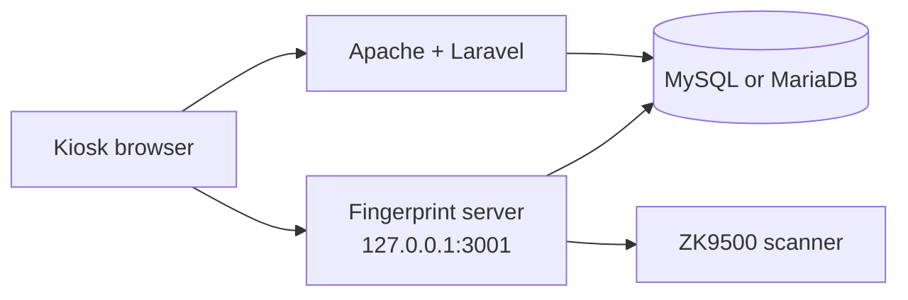
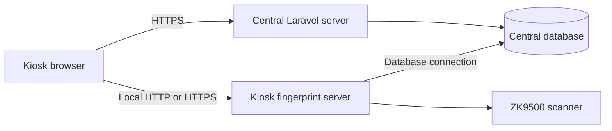

# Deployment Guide

This guide covers the permanent deployment of the Attendance Monitoring System on Windows. It assumes the software installation and database migrations are already complete.

For first-time setup, see [INSTALLATION.md](INSTALLATION.md). For the scanner, see [FINGERPRINT_SETUP.md](FINGERPRINT_SETUP.md).

> Hardware notice: the ZK9500 scanner, SDK, and fingerprint matching were not verified in the environment used to prepare this document. Complete the hardware checklist on the target kiosk.

## 1. Deployment Topologies

### Option A: Single All-in-One Kiosk PC

Recommended for one attendance station.



All components run on one Windows PC:

- Apache and Laravel
- MySQL/MariaDB
- Node.js fingerprint server
- ZK9500 scanner
- Kiosk browser

Advantages:

- No network dependency for attendance.
- Simpler scanner and CORS configuration.
- Simpler backup and support.

### Option B: Central Laravel Server Plus Kiosk PC

Use this when multiple attendance stations share one database.



Important rules for this layout:

- Laravel and the database can be on the central server.
- The fingerprint server must run on each kiosk PC because the scanner is USB-local.
- The browser still calls `127.0.0.1:3001`; it does not call the central server for fingerprint capture.
- The fingerprint server connects to the central database.
- Add the central Laravel origin to `CORS_ORIGINS`.
- Use HTTPS for the central Laravel application.
- Restrict database access to the kiosk and application hosts.
- Do not expose port `3001` to the internet.

## 2. Pre-Deployment Checklist

- [ ] A tested database backup exists.
- [ ] The software-only installation works.
- [ ] Employees and schedules are configured.
- [ ] Visitor photo storage works.
- [ ] A plan exists for the scanner hardware and SDK.
- [ ] The target deployment topology is selected.
- [ ] The PC has a stable timezone and time source.
- [ ] The Windows account that runs services has access to the project directory and scanner.
- [ ] You know how the fingerprint server will start after reboot.
- [ ] You know how the database will be backed up.

## 3. Production Environment Settings

Open the Laravel `.env`:

```powershell
Set-Location "C:\xampp\htdocs\attendance_app"
notepad .env
```

Use values appropriate to your deployment:

```dotenv
APP_NAME="Attendance Monitoring System"
APP_ENV=production
APP_DEBUG=false
APP_URL=https://attendance.example.local

DB_CONNECTION=mysql
DB_HOST=127.0.0.1
DB_PORT=3306
DB_DATABASE=attendance_app
DB_USERNAME=attendance_app
DB_PASSWORD=REPLACE_WITH_A_STRONG_PASSWORD

SESSION_DRIVER=database
SESSION_SECURE_COOKIE=true
CACHE_STORE=database
QUEUE_CONNECTION=database

LOG_CHANNEL=stack
LOG_LEVEL=warning
```

Do not use the example password. Do not commit the real `.env`.

### HTTPS Requirement in Production

`app/Providers/AppServiceProvider.php` forces HTTPS URL generation when the application environment is `production`.

That means:

- A production deployment must have valid HTTPS configured.
- If you serve a production environment only over `http://localhost`, generated URLs can point to `https://localhost` and fail.
- For a local-only kiosk without TLS, keep the environment out of `production` mode and use `APP_DEBUG=false`. This is a local deployment compromise, not internet-facing hardening.
- Prefer configuring HTTPS rather than weakening the deployment.

A reverse proxy or Apache TLS virtual host can terminate HTTPS. The application already trusts forwarded proxy headers.

### Database Account

For production, use a dedicated database account instead of XAMPP's `root` account. Grant it access only to the `attendance_app` database.

The Laravel application and the fingerprint server must use the same database.

If the fingerprint server connects to a remote database that requires TLS, set `DB_SSL=true` in `fingerprint-server\.env`.

## 4. Apache Deployment

### Document Root

Apache must serve the `public` directory:

```text
C:\xampp\htdocs\attendance_app\public
```

Do not use the project root as `DocumentRoot`. Doing so exposes `.env`, application code, logs, and backups.

### Virtual Host Example

```apache
<VirtualHost *:80>
    ServerName attendance.example.local
    DocumentRoot "C:/xampp/htdocs/attendance_app/public"

    <Directory "C:/xampp/htdocs/attendance_app/public">
        Options FollowSymLinks
        AllowOverride All
        Require all granted
    </Directory>

    ErrorLog "logs/attendance-error.log"
    CustomLog "logs/attendance-access.log" combined
</VirtualHost>
```

For HTTPS, add a TLS virtual host with a certificate trusted by the kiosk browsers. Internal deployments can use a certificate issued by the organization's certificate authority. Avoid using a public self-signed certificate without installing it in the kiosk trust store.

### Required Apache Configuration

- Enable `mod_rewrite`.
- Allow `.htaccess` overrides for the `public` directory.
- Confirm `public\.htaccess` exists.
- Restart Apache after configuration changes.
- Point `APP_URL` to the address users actually open.
- Add the same origin to `fingerprint-server\.env` under `CORS_ORIGINS`.

### PHP Settings for Production

At minimum:

```ini
upload_max_filesize = 10M
post_max_size = 12M
max_execution_time = 60
memory_limit = 256M
display_errors = Off
log_errors = On
```

The application should not display detailed errors in production. Laravel logging remains available in `storage\logs`.

### File Permissions

Ensure the Apache service account can write to:

- `storage`
- `bootstrap\cache`
- `public\storage`

Do not grant `Everyone` broad modify access. Use the actual service account and the minimum required permissions.

## 5. Application Cache and Configuration

After changing `.env` or deployment settings:

```powershell
Set-Location "C:\xampp\htdocs\attendance_app"
php artisan optimize:clear
php artisan config:cache
php artisan view:cache
```

Notes:

- `config:cache` makes Laravel use the cached environment configuration. Run `config:clear` before editing `.env`, then cache again.
- Avoid `route:cache` for this repository unless you have reviewed the closure routes in `routes/web.php`. Laravel may reject routes defined with closures during route caching.
- Use `php artisan optimize:clear` after deployments that change configuration or views.

## 6. Starting the Components

### Start Order

Use this order after a reboot:

1. MySQL/MariaDB
2. Apache
3. Fingerprint server
4. Kiosk browser

The fingerprint server will retry initial database connection failures, but starting the database first avoids repeated errors.

### Apache and MySQL as Windows Services

For a permanent kiosk, configure Apache and MySQL as Windows services. The XAMPP Control Panel can install them as services.

Verify they start after reboot before relying on the system.

### Fingerprint Server Default Startup

The default command is:

```powershell
Set-Location "C:\xampp\htdocs\attendance_app\fingerprint-server"
npm start
```

This runs `watchdog.js`, which starts `server.js` and restarts it after an unexpected exit. It does not start automatically at boot.

### Windows Task Scheduler

Use Task Scheduler for native auto-start without PM2.

Suggested task:

- Program/script: `C:\Program Files\nodejs\npm.cmd`
- Arguments: `start`
- Start in: `C:\xampp\htdocs\attendance_app\fingerprint-server`
- Trigger: at system startup or at kiosk user logon
- Run whether the user is logged on or not, if scanner access permits

Test the task by rebooting the PC and checking `/health`.

### Optional PM2

PM2 is not installed or configured by this repository. It is an optional process manager.

If you choose PM2, use `server.js` directly and let PM2 restart it, or use the project's `watchdog.js`. Do not stack restart managers unnecessarily.

PM2 commands must not be treated as the default deployment method. See [COMMAND_REFERENCE.md](COMMAND_REFERENCE.md#12-optional-pm2-commands-for-windows).

PM2 on Windows does not provide the same native boot integration as Linux `systemd`. Use Task Scheduler for boot persistence, or run `pm2 resurrect` from a startup task.

## 7. Kiosk Configuration

Recommended kiosk setup:

- Use Chrome or Edge.
- Open `/kiosk` or `/scan/employee/zk9500`.
- Set the browser to full-screen or kiosk mode.
- Disable sleep and screen timeout.
- Set the PC timezone to the intended attendance timezone.
- Keep the scanner connected to a stable USB port.
- Disable USB selective suspend if the scanner disconnects when idle.
- Protect the Windows account with a password.
- Prevent users from closing the fingerprint server terminal if it runs in a visible window.

If the fingerprint server is started through Task Scheduler, it can run without a visible terminal. Use its log output or PM2 logs if you need ongoing visibility.

## 8. Network and Firewall

| Port | Purpose | Exposure |
| --- | --- | --- |
| `80` | HTTP | Local network or redirect to HTTPS |
| `443` | HTTPS | Kiosk and admin network only |
| `3001` | Fingerprint REST and WebSocket | Local kiosk only; do not expose publicly |
| `3306` | MySQL/MariaDB | Localhost only, or restricted to application hosts |

The fingerprint server API has no authentication. Restrict port `3001` with Windows Firewall. If the Node server only needs loopback access, limit it to the local machine.

In a centralized layout, the kiosk browser still uses the local fingerprint server, but the server connects outbound to the central database. Do not open the database port to the whole network.

## 9. Security Checklist

- [ ] Set `APP_DEBUG=false`.
- [ ] Set a strong `APP_KEY`.
- [ ] Use HTTPS for any non-local deployment.
- [ ] Replace the XAMPP `root` database account with a limited application account.
- [ ] Restrict `/register` by network or reverse-proxy authentication.
- [ ] Remove any seeded test account.
- [ ] Keep the fingerprint server port `3001` off the public network.
- [ ] Back up `.env` securely and never commit it.
- [ ] Back up the database and visitor photos.
- [ ] Do not expose `.env`, `storage`, `vendor`, or logs through Apache.
- [ ] Restrict physical access to the kiosk and scanner.
- [ ] Keep Windows, PHP, Apache, MySQL/MariaDB, Composer dependencies, and Node packages updated.
- [ ] Review database and web-server logs regularly.
- [ ] Test restoring a backup before relying on it.

There is no role-based access control. Any account that can log in can manage all records. Because registration is public, network restriction is important.

## 10. Backup

### What to Back Up

- The MySQL/MariaDB `attendance_app` database.
- Visitor photos in `storage\app\public\visitors`.
- The Laravel `.env` file, stored securely.
- Any custom TLS certificates.
- The fingerprint server `.env`, stored securely.
- A copy of the deployed source version or Git commit.

### Database Backup

Create a backup directory:

```powershell
New-Item -ItemType Directory -Force -Path "C:\xampp\htdocs\attendance_app\storage\backups"
```

Use `mysqldump` with `--result-file` instead of PowerShell redirection:

```powershell
& "C:\xampp\mysql\bin\mysqldump.exe" -u root --single-transaction --routines --triggers attendance_app --result-file="C:\xampp\htdocs\attendance_app\storage\backups\attendance_app_2026-11-12.sql"
```

If your account has a password, add `-p` and enter it when prompted. Do not put the password directly in the command or in documentation.

### Photo Backup

```powershell
Copy-Item -Path "C:\xampp\htdocs\attendance_app\storage\app\public\visitors" -Destination "D:\Backups\attendance_visitors" -Recurse -Force
```

Choose an appropriate backup destination and retention policy.

### Restore

For a controlled restore, stop writes to the application, back up the current database, then restore with the MySQL client. In PowerShell, use `cmd /c` for input redirection:

```powershell
cmd /c "C:\xampp\mysql\bin\mysql.exe -u root -p attendance_app < C:\xampp\htdocs\attendance_app\storage\backups\attendance_app_2026-11-12.sql"
```

You can also import the SQL file through phpMyAdmin. Test the restore on a non-production copy first.

## 11. Upgrade Procedure

1. Announce a maintenance window.
2. Back up the database and visitor photos.
3. Put Laravel into maintenance mode:

```powershell
Set-Location "C:\xampp\htdocs\attendance_app"
php artisan down
```

4. Pull or copy the new release.
5. Install PHP dependencies:

```powershell
composer install --no-dev --optimize-autoloader
```

6. Run migrations:

```powershell
php artisan migrate --force
```

7. Clear and rebuild caches:

```powershell
php artisan optimize:clear
php artisan config:cache
php artisan view:cache
```

8. If fingerprint server dependencies changed:

```powershell
Set-Location "C:\xampp\htdocs\attendance_app\fingerprint-server"
npm install
```

9. Restart the fingerprint server.
10. Verify `/up`, login, `/kiosk`, fingerprint health, enrollment, and a test scan.
11. Exit maintenance mode:

```powershell
Set-Location "C:\xampp\htdocs\attendance_app"
php artisan up
```

Never use `migrate:fresh` during an upgrade.

## 12. Rollback

1. Put the application into maintenance mode.
2. Restore the previous source release.
3. Restore the database backup if the new release changed the schema or data incompatibly.
4. Run `composer install --no-dev --optimize-autoloader` for the restored release.
5. Clear and rebuild caches.
6. Restart Apache and the fingerprint server.
7. Exit maintenance mode.
8. Verify login, attendance, visitors, and fingerprint health.

Keep the database backup until the new release has been validated.

## 13. Logs and Monitoring

| Source | Location |
| --- | --- |
| Laravel application | `storage\logs\laravel.log` |
| Apache | XAMPP Apache logs directory |
| PHP | Apache/PHP error log |
| MySQL/MariaDB | XAMPP MySQL data directory and error log |
| Fingerprint server | The terminal running `npm start`, or PM2 logs |
| Health check | `http://127.0.0.1:3001/health` |
| Laravel health | `https://your-app/up` |

Suggested checks:

```powershell
Invoke-RestMethod -Uri "http://127.0.0.1:3001/health" | ConvertTo-Json -Depth 5
Invoke-WebRequest -Uri "https://attendance.example.local/up" -UseBasicParsing
```

`/health` returns `status: ok` whenever the HTTP server is running. Check `scanner.simulationMode` and the database-backed endpoints separately.

## 14. Post-Deployment Verification

### Software

- [ ] Apache and MySQL start after reboot.
- [ ] Laravel `/up` responds over the deployed address.
- [ ] Login works.
- [ ] Registration is restricted or otherwise controlled.
- [ ] Dashboard loads.
- [ ] Employee list loads.
- [ ] Schedule creation works.
- [ ] Manual attendance works.
- [ ] Visitor registration with a photo works.
- [ ] Visitor checkout works.
- [ ] Visitor log filters work. CSV export has a documented datetime formatting defect.
- [ ] Attendance print pages work.
- [ ] Visitor photos survive a reboot.
- [ ] Database backup completes and can be read.

### Fingerprint

- [ ] Fingerprint server starts after reboot using the chosen startup method.
- [ ] `/health` reports `simulationMode: false`.
- [ ] `/health` reports a connected scanner.
- [ ] `/api/employees` returns database data.
- [ ] Fingerprint enrollment succeeds.
- [ ] A test scan records time-in.
- [ ] A second test scan records time-out.
- [ ] A no-schedule employee is rejected.
- [ ] Restarting the fingerprint server does not lose configuration.
- [ ] Port `3001` is not reachable from untrusted networks.

### Security

- [ ] `.env` is not served by Apache.
- [ ] Directory listing is disabled.
- [ ] The database account is not `root`.
- [ ] Test accounts are removed or secured.
- [ ] Backups are protected.
- [ ] The kiosk uses the intended timezone.
- [ ] Windows Firewall rules match the topology.

## 15. Known Deployment Constraints

- PM2 is not configured by the project. Use `npm start` and the built-in watchdog, or add PM2 as a separate operational choice.
- The browser calls `127.0.0.1:3001`, so the fingerprint server must run on the kiosk PC.
- `WS_PORT=3002` in the example environment is unused; WebSocket traffic uses the main server port at `/ws`.
- The ZK9500 SDK and DLL must match the Node.js architecture and have the required runtime installed.
- Public registration and the unauthenticated fingerprint API require network and physical security controls.
- The visitor CSV export route currently raises `InvalidFormatException` because of datetime formatting. It requires a source correction before the export can be used reliably.
- There is no automated high-availability, queue-based failover, or central device-management system.
- The repository has no container, systemd, or CI/CD deployment configuration.
