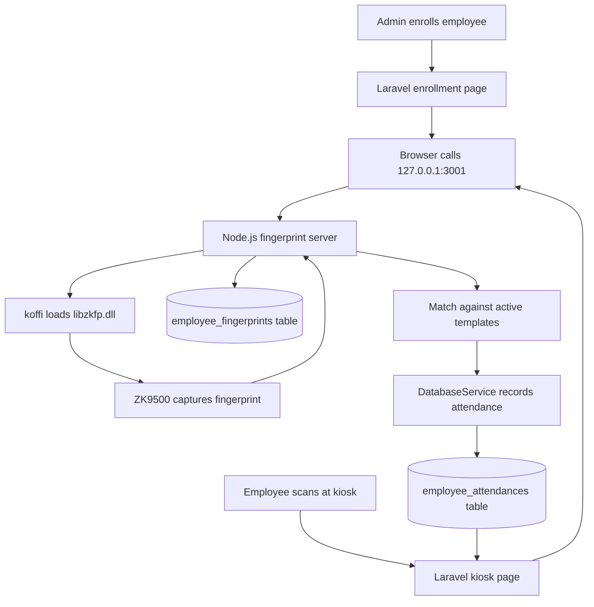

# ZK9500 Fingerprint Setup

This guide configures the separate Node.js fingerprint service and the ZKTeco ZK9500 scanner.

> Hardware verification status: no physical ZK9500 scanner or working SDK environment was available while these documents were prepared. Installation, DLL loading, detection, enrollment, matching, and attendance recording through the scanner must be verified on the target Windows PC.

## 1. How the Fingerprint Flow Works



- The Laravel page runs in the browser.
- The browser calls the fingerprint server at `http://127.0.0.1:3001`.
- The fingerprint server uses `koffi` to load the ZKTeco `libzkfp.dll`.
- Fingerprint templates and attendance records are written directly to the shared MySQL/MariaDB database.
- Laravel and the fingerprint server must use the same database.

The browser code tries these addresses in order:

1. `http://127.0.0.1:3001`
2. `http://localhost:3001`

The fingerprint server must therefore run on the same PC as the browser and scanner. In a centralized deployment, the Laravel application can run on a server, but the fingerprint server must run on each kiosk PC.

## 2. Requirements

### Hardware

- ZKTeco ZK9500 fingerprint scanner.
- A working USB connection.
- Windows 10 or Windows 11.
- Administrative rights to install the SDK and device driver.

### Software

- Node.js. Node 22.12+ or Node 20.19+ is recommended.
- The ZKFinger SDK for the ZK9500.
- The Microsoft Visual C++ Redistributable required by the SDK and DLL.
- A working Laravel installation and database.
- At least one employee with a schedule.

Use the same architecture for Node.js and the DLL. A 64-bit Node.js process normally requires a 64-bit DLL. A 32-bit DLL requires a 32-bit Node.js process.

Official links:

- ZKTeco downloads: https://www.zkteco.com/en/Downloads
- Microsoft Visual C++ Redistributable: https://learn.microsoft.com/en-us/cpp/windows/latest-supported-vc-redist
- Node.js: https://nodejs.org/en/download

## 3. Fingerprint Server Files

| Path | Purpose |
| --- | --- |
| `fingerprint-server\server.js` | Express server, WebSocket server, and health endpoint |
| `fingerprint-server\watchdog.js` | Starts `server.js` and restarts it if it exits |
| `fingerprint-server\services\ZKFingerprintService.js` | SDK loading, capture, enrollment, matching, and device status |
| `fingerprint-server\services\DatabaseService.js` | Database queries and attendance evaluation |
| `fingerprint-server\routes\index.js` | REST API endpoints |
| `fingerprint-server\sdk\libzkfp.dll` | Bundled ZKTeco DLL fallback |
| `fingerprint-server\.env.example` | Example fingerprint server configuration |

The repository contains the bundled DLL at:

```text
C:\xampp\htdocs\attendance_app\fingerprint-server\sdk\libzkfp.dll
```

The SDK installer may provide a newer or more complete DLL and supporting libraries. Installing the official SDK is recommended for a real scanner.

## 4. SDK and DLL Loading

The loader checks the following paths in order:

1. The value of `ZKTECO_SDK_PATH`
2. `C:/Program Files/ZKTeco/SDK/libzkfp.dll`
3. `C:/Program Files (x86)/ZKTeco/SDK/libzkfp.dll`
4. `C:/Windows/System32/libzkfp.dll`
5. `C:/Windows/SysWOW64/libzkfp.dll`
6. `fingerprint-server\sdk\libzkfp.dll`
7. `attendance_app\sdk\libzkfp.dll`

### Important Path Detail

`ZKTECO_SDK_PATH` must be the **full path to the DLL file**, not merely a directory.

The example file currently shows:

```dotenv
ZKTECO_SDK_PATH=C:/Program Files/ZKTeco/ZK9500/
```

That value is a directory. The loader expects a file path and will attempt to load the path exactly as provided. If loading fails, it continues to the standard locations and the bundled DLL fallback.

Use a full DLL path when you know where the SDK was installed:

```dotenv
ZKTECO_SDK_PATH=C:/Program Files/ZKTeco/SDK/libzkfp.dll
```

If you want to rely on the bundled DLL, you can leave `ZKTECO_SDK_PATH` blank or point it directly to:

```dotenv
ZKTECO_SDK_PATH=C:/xampp/htdocs/attendance_app/fingerprint-server/sdk/libzkfp.dll
```

Do not modify the JavaScript source to compensate for a directory-style environment variable. Fix the environment value or use the bundled fallback.

### Locate an Installed DLL

```powershell
Get-ChildItem "C:\Program Files\ZKTeco" -Recurse -Filter "libzkfp.dll" -ErrorAction SilentlyContinue |
    Select-Object FullName, Length, LastWriteTime
```

Check the bundled fallback:

```powershell
Test-Path "C:\xampp\htdocs\attendance_app\fingerprint-server\sdk\libzkfp.dll"
Get-Item "C:\xampp\htdocs\attendance_app\fingerprint-server\sdk\libzkfp.dll" |
    Select-Object FullName, Length, LastWriteTime
```

Do not download DLLs from unofficial sources.

## 5. Install the ZKTeco SDK

1. Download the ZKFinger SDK or the ZK9500 driver package from the official ZKTeco download page.
2. Run the installer as an administrator.
3. Install the Microsoft Visual C++ Redistributable if the installer or scanner software requires it.
4. Reboot Windows if the installer requests it.
5. Open Device Manager.
6. Connect the ZK9500.
7. Confirm that Windows detects it, normally under biometric or USB devices.

If Device Manager shows a warning, update or reinstall the ZKTeco driver before continuing.

The helper script `setup-zkteco-sdk.bat` in the project root opens the ZKTeco download page and repeats these basic options. It does not install the SDK automatically.

## 6. Configure the Fingerprint Server environment

```powershell
Set-Location "C:\xampp\htdocs\attendance_app\fingerprint-server"
Copy-Item -LiteralPath ".env.example" -Destination ".env"
notepad .env
```

Use values that match your environment:

```dotenv
DB_HOST=127.0.0.1
DB_PORT=3306
DB_USER=root
DB_PASSWORD=
DB_NAME=attendance_app
DB_SSL=false

PORT=3001
FINGERPRINT_SSL=false

CORS_ORIGINS=http://localhost:8000,http://127.0.0.1:8000

ZKTECO_SDK_PATH=C:/Program Files/ZKTeco/SDK/libzkfp.dll
FINGERPRINT_THRESHOLD=50

TIME_IN_WINDOW_MINUTES=240
OVERTIME_MINUTES=60
UNDERTIME_MINUTES=60
```

### Configuration Notes

| Setting | Meaning |
| --- | --- |
| `DB_HOST`, `DB_PORT`, `DB_USER`, `DB_PASSWORD`, `DB_NAME` | Must match the Laravel database |
| `DB_SSL` | Keep `false` for local MySQL/MariaDB unless your database requires TLS |
| `PORT` | REST and WebSocket server port; default `3001` |
| `FINGERPRINT_SSL` | Keep `false` for local HTTP; see the TLS note below |
| `CORS_ORIGINS` | Browser origins allowed to call the fingerprint server |
| `ZKTECO_SDK_PATH` | Full path to the DLL, not a directory |
| `FINGERPRINT_THRESHOLD` | Match threshold from 0 to 100; higher is stricter |
| `TIME_IN_WINDOW_MINUTES` | Maximum late minutes before attendance becomes Absent; default `240` |
| `OVERTIME_MINUTES` | Extra minutes needed to flag overtime; default `60` |
| `UNDERTIME_MINUTES` | Missing minutes needed to flag undertime; default `60` |

Additional facts about the current server:

- The WebSocket endpoint is `/ws` on the same `PORT` as the REST API, normally `3001`.
- `WS_PORT=3002` appears in the example file but is not read by the current server. Do not configure the browser for port `3002`.
- If `FINGERPRINT_THRESHOLD` is omitted, the service falls back to `75`. The example file uses `50`.
- If `FINGERPRINT_SSL` is missing from the environment, the server defaults toward HTTPS mode, but falls back to HTTP when certificate files are absent. Keep it explicitly `false` for a normal local kiosk.
- TLS certificate files are not included. The `fingerprint-server\certs` directory contains only a placeholder. Do not enable TLS unless you have created valid certificates.
- `LARAVEL_API_URL` and `MAX_TEMPLATE_SIZE` appear in some environment examples but are not required by the current server operation.

### CORS Origins

`CORS_ORIGINS` must contain the exact browser origin used to open Laravel.

Examples:

```text
http://localhost:8000
http://127.0.0.1:8000
http://attendance.local
https://attendance.example.com
```

Separate multiple origins with commas. The scheme, host, and port must match exactly.

The server always allows `http://localhost:8000` and `http://127.0.0.1:8000` in addition to configured origins.

## 7. Install Fingerprint Server Dependencies

```powershell
Set-Location "C:\xampp\htdocs\attendance_app\fingerprint-server"
npm install
```

Confirm Node and npm:

```powershell
node -v
npm -v
```

## 8. Start the Fingerprint Server

The default startup method is:

```powershell
Set-Location "C:\xampp\htdocs\attendance_app\fingerprint-server"
npm start
```

`npm start` runs `watchdog.js`. The watchdog starts `server.js` and restarts it after an unexpected exit. It does not start automatically when Windows boots.

Other scripts:

| Command | Behavior |
| --- | --- |
| `npm start` | Runs `watchdog.js`, which manages `server.js` |
| `npm run start:direct` | Runs `server.js` without the watchdog |
| `npm run dev` | Runs `server.js` under nodemon for development |

Expected startup information includes:

- The listening port, normally `3001`.
- Whether the server is running HTTP or HTTPS.
- The REST API URL.
- The WebSocket URL.
- The health-check URL.
- Database connection status.
- SDK load result.
- Device count.
- A simulation-mode warning when no real scanner is available.

The server starts listening before service initialization finishes. If you check health immediately after starting it, `initialized` may still be `false` for a moment.

If port `3001` is already in use, the server logs an `EADDRINUSE` error and retries every five seconds. Stop the duplicate process or change `PORT` and the browser code would also need a matching address; changing the port is not supported by the current frontend without source changes.

## 9. Check Scanner Health

The health endpoint:

```powershell
Invoke-RestMethod -Uri "http://127.0.0.1:3001/health" | ConvertTo-Json -Depth 5
```

The status endpoint:

```powershell
Invoke-RestMethod -Uri "http://127.0.0.1:3001/api/status" | ConvertTo-Json -Depth 5
```

`GET /health` returns:

- `status`
- `scanner`
- `timestamp`

The scanner object includes:

- `initialized`
- `connected`
- `simulationMode`
- `deviceCount`
- `disconnectStrikeCount`
- `busy`
- `currentOperation`

`GET /api/status` returns the same scanner object with `success: true` and `server: "online"`.

### Real Scanner Expected Values

After initialization with a working scanner:

```text
status                  : ok
scanner.initialized     : True
scanner.connected       : True
scanner.simulationMode  : False
scanner.deviceCount     : 1 or more, or null while busy
scanner.busy            : False when idle
scanner.currentOperation: idle when idle
```

`deviceCount` can be `null` while a capture is in progress.

### Simulation Mode

If the DLL cannot be loaded or no device is detected, the service starts in simulation mode:

```text
scanner.simulationMode : True
```

In simulation mode:

- The HTTP server can still respond successfully.
- The scanner may appear connected in health output.
- Captures return simulated random data.
- Enrollment is rejected with an error.
- Simulated captures cannot provide real attendance verification.

A health response with `status: ok` only proves that the HTTP server is responding. Always check `simulationMode` and the server console.

### Database Health

The health endpoint does not prove that the database is reachable. Check a database-backed endpoint:

```powershell
Invoke-RestMethod -Uri "http://127.0.0.1:3001/api/employees" | ConvertTo-Json -Depth 5
```

If this fails, check the fingerprint server console and its database settings.

## 10. Enroll an Employee Fingerprint

Enrollment is an authenticated admin action.

1. Log in to Laravel.
2. Open `/users`.
3. Choose **Display All Employees**.
4. Select the fingerprint icon for the employee.
5. The enrollment page opens at `/scan/employee/zk9500/enroll`.
6. Confirm the scanner status shows a real scanner, not simulation mode.
7. Select the employee if the page did not preselect one.
8. Click **Start Enrollment**.
9. Place the finger on the ZK9500 when prompted.
10. Wait for the success message.

A direct enrollment link can preselect an employee by employee number:

```text
http://localhost:8000/scan/employee/zk9500/enroll?employee_id=EMP-2026-001
```

The page also accepts a validated `return_url` for the Back navigation.

What the server does during enrollment:

1. Looks up the employee in the database.
2. Captures a fingerprint template from the real scanner.
3. Calculates a quality value.
4. Saves the base64 template in `employee_fingerprints`.
5. Uses finger index `0` by default.
6. Updates the existing finger index instead of creating a duplicate when re-enrolling.

Enrollment does not create an attendance record.

If the employee already has an enrolled fingerprint, the UI warns that re-enrollment will overwrite it.

## 11. Record Attendance at the Kiosk

1. Open `/kiosk`.
2. Choose **Biometric Scan (ZK9500)**.
3. Alternatively, open `/scan/employee/zk9500` directly.
4. Select the employee for strict verification, or leave the selection empty for broad matching.
5. Click **Start Scanning**.
6. Place the enrolled finger on the scanner.

For strict verification, the selected employee is sent to the server. If the fingerprint belongs to a different employee, attendance is not recorded and the page reports a mismatch.

If no employee is selected, the server compares the captured fingerprint against all active enrolled templates.

### Attendance Action Sequence

For a normal scheduled day, repeated scans fill these slots in order:

1. First scan: `time_in`
2. Second scan: `time_out`
3. Third scan: `time_in_2`
4. Fourth scan: `time_out_2`
5. Fifth scan: `time_in_3`
6. Sixth scan: `time_out_3`
7. Seventh scan: `time_in_4`
8. Eighth scan: `time_out_4`

Further scans report that the maximum of four time-in/time-out pairs has been reached.

### Schedule Validation

The ZK9500 flow rejects attendance when the employee has no schedule for the current weekday.

The rejection reason is shown in the kiosk. This is intentional: an employee must have an active schedule entry for that day before biometric attendance can be recorded.

### Time-In Status

The first time-in is compared with the scheduled start time:

- At or before the scheduled start: `Present`.
- After the scheduled start but within the configured late window: `Late`.
- More than the late window after the scheduled start: `Absent`, and no time-in is recorded.

The default late window is 240 minutes. You can change it through `TIME_IN_WINDOW_MINUTES` in `fingerprint-server\.env`.

### Overtime and Undertime

The server calculates extra and missing minutes relative to the scheduled end time:

- Extra minutes at or above `OVERTIME_MINUTES` produce an overtime flag.
- Missing minutes at or above `UNDERTIME_MINUTES` produce an undertime flag.

These are evaluation flags returned with attendance data. They do not replace the stored attendance status enum by themselves.

### Time Zone

The Node.js process uses the Windows local time to choose the attendance date, while the database uses `CURTIME()` for the time values. Set Windows and MySQL/MariaDB to the intended timezone, normally UTC+8 for `Asia/Manila`.

If the PC timezone is wrong, scans can be assigned to the wrong date or time.

## 12. Restart and Auto-Start

### Default Behavior

`watchdog.js` restarts the fingerprint server if it crashes, but it must already be running. Use one of these methods to start it after Windows boots:

- Manually open a terminal and run `npm start`.
- Use a Windows Startup shortcut.
- Use Windows Task Scheduler.
- Use PM2 as an optional process manager.

The Laravel application can be started automatically by running Apache and MySQL as Windows services through XAMPP.

### Optional PM2

PM2 is not a project dependency and is not the configured process manager. It is an optional Windows administration tool. Commands are in [COMMAND_REFERENCE.md](COMMAND_REFERENCE.md#12-optional-pm2-commands-for-windows).

If PM2 is used, it normally runs `server.js` directly and provides its own restart handling. Do not run both PM2 restart logic and a second watchdog unnecessarily.

### Windows Task Scheduler

Use Task Scheduler for native Windows auto-start.

- Program/script: the full path to `npm.cmd`, for example `C:\Program Files\nodejs\npm.cmd`
- Arguments: `start`
- Start in: `C:\xampp\htdocs\attendance_app\fingerprint-server`
- Trigger: at startup or at user logon

Confirm the task runs under an account that can access the USB scanner.

## 13. Troubleshooting

### `Could not find libzkfp.dll in any standard location`

- Confirm the bundled DLL exists.
- Install the official SDK.
- Set `ZKTECO_SDK_PATH` to the full DLL path.
- Do not point it to a directory.
- Restart the fingerprint server after changing `.env`.
- Check the server console for each attempted path.

### DLL Is Found but Loading Fails

- Install the Microsoft Visual C++ Redistributable.
- Confirm the DLL and Node.js architecture match.
- Try the DLL installed by the official SDK instead of the bundled fallback.
- Check that no security policy blocks loading the DLL.

### Device Count Is Zero

- Reconnect the ZK9500.
- Check Device Manager for driver errors.
- Close other fingerprint applications that may be holding the device.
- Restart the fingerprint server.
- Try another USB port, preferably a directly connected port rather than an unpowered hub.

### Scanner Reports Simulation Mode

Simulation mode means the real SDK or device is not available. Enrollment will fail. Fix DLL loading and USB detection before testing attendance.

### `Cannot enroll fingerprint in simulation mode`

This is the expected protection. Connect a real ZK9500 and confirm health reports `simulationMode: false`.

### Browser Cannot Reach the Fingerprint Server

- Confirm `npm start` is running.
- Check `http://127.0.0.1:3001/health` in the same browser PC.
- Check the server console for `EADDRINUSE`.
- Confirm Windows Firewall is not blocking local loopback.
- Confirm the browser is not being blocked from a public page to a loopback address. Use the local Laravel URL, or configure HTTPS for the fingerprint server when required.

### CORS Error

Add the exact Laravel origin to `CORS_ORIGINS`:

```dotenv
CORS_ORIGINS=http://localhost:8000,http://127.0.0.1:8000,http://attendance.local
```

Restart the fingerprint server after changing `.env`.

A mismatch in scheme (`http` versus `https`), hostname, or port causes CORS failure.

### Fingerprint Server Cannot Connect to the Database

- Confirm MySQL/MariaDB is running.
- Confirm the fingerprint `.env` database values match Laravel's `.env`.
- Confirm the `attendance_app` database exists and migrations have run.
- Test `/api/employees`.
- Check the server console for the MySQL error.

The health endpoint can still return `status: ok` while the database is unavailable.

### Port 3001 Is Already in Use

```powershell
Get-NetTCPConnection -LocalPort 3001 -State Listen
```

Stop the duplicate Node process:

```powershell
Get-Process node
```

Do not change the port unless you also update the frontend code, which currently hardcodes `127.0.0.1:3001` and `localhost:3001`.

### Capture Timeout

- Place the finger firmly on the scanner.
- Clean the scanner surface.
- Confirm the employee is using the expected finger.
- Reconnect the device if captures repeatedly time out.
- Check the server console for SDK error codes.

### Fingerprint Does Not Match

- Confirm the employee was enrolled with the same scanner.
- Confirm the selected employee matches the finger being used.
- Check that the template is active in `employee_fingerprints`.
- Re-enroll the fingerprint if the template is poor quality.
- Review `FINGERPRINT_THRESHOLD`; a higher value is stricter.

### Attendance Rejected Because There Is No Schedule

Create a schedule for the employee for the current weekday in Laravel. The kiosk does not fall back to a generic schedule.

### Attendance Shows the Wrong Date or Time

Set Windows and MySQL/MariaDB to the correct timezone. The Node process computes the local date, and the database supplies `CURTIME()`.

## 14. Security Notes

- The fingerprint API has no authentication or authorization.
- Keep port `3001` bound to the local kiosk or protected by Windows Firewall.
- Do not expose the fingerprint server to the internet.
- Fingerprint templates are stored in the database. Protect database backups and restrict database access.
- Only administrators should have access to the enrollment page.
- Windows Hello/WebAuthn is a separate biometric flow and is not a substitute for the ZK9500 configuration in this document.

## 15. Hardware Verification Checklist

Complete these checks on the target kiosk:

- [ ] Official ZKTeco SDK and required runtime are installed.
- [ ] The DLL path is correct or the bundled DLL loads successfully.
- [ ] Device Manager detects the ZK9500.
- [ ] `npm start` runs without restart loops.
- [ ] `/health` reports `simulationMode: false`.
- [ ] `/health` reports `initialized: true` and `connected: true`.
- [ ] Device count is at least one when idle.
- [ ] An employee fingerprint enrolls successfully.
- [ ] The template appears in `employee_fingerprints`.
- [ ] The first scan records a time-in.
- [ ] The second scan records a time-out.
- [ ] Additional scans fill the remaining pairs up to four.
- [ ] A selected-employee mismatch is rejected.
- [ ] An employee without a schedule for the day is rejected.
- [ ] Restarting the server and scanning again works.
- [ ] Restarting Windows and following the chosen startup method works.

Do not mark biometric acceptance complete until these checks pass on real hardware.
