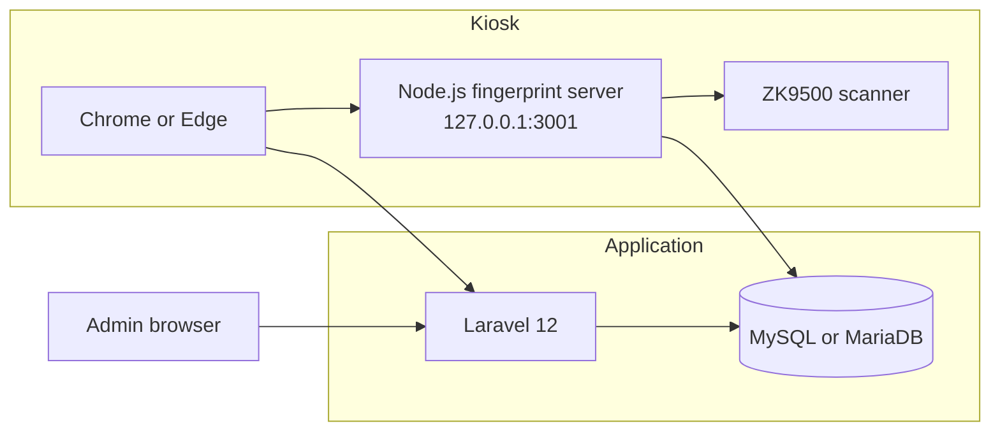
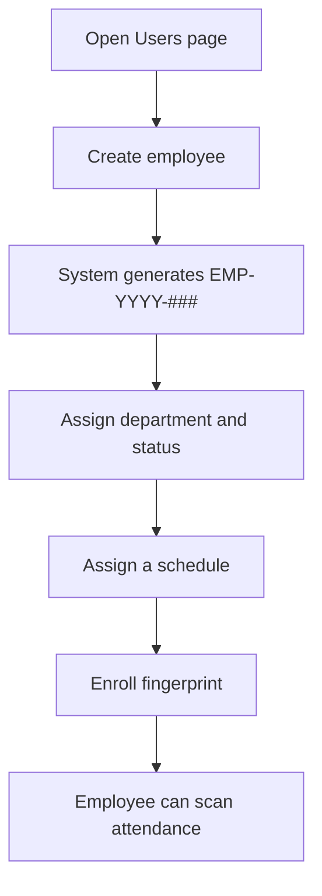
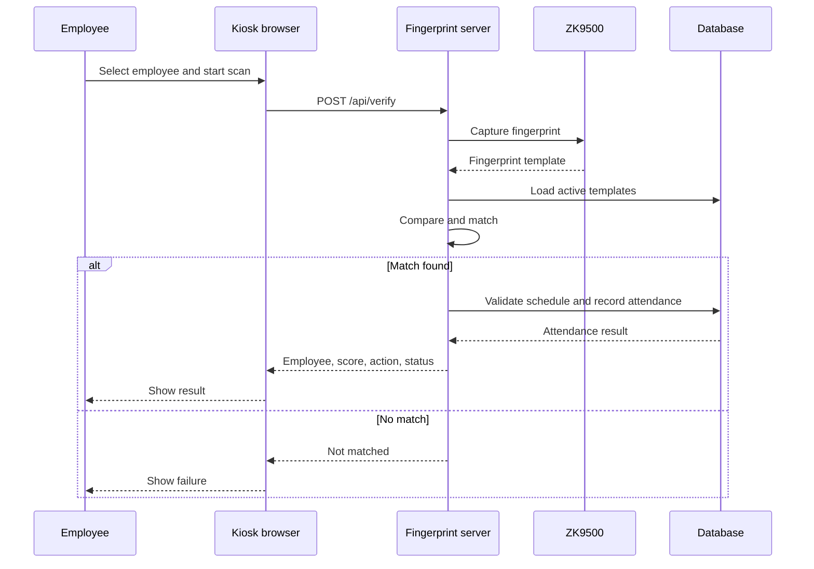
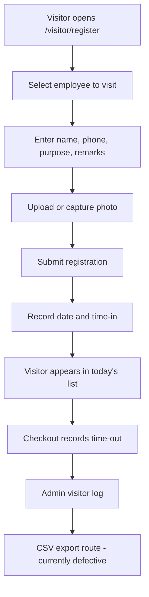
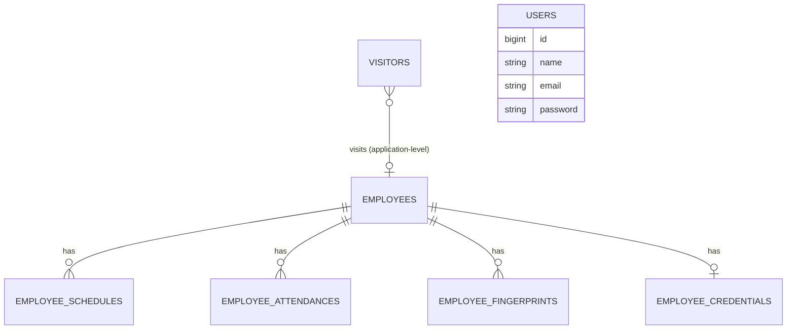

# Project Workflow

This document explains what the Attendance Monitoring System does, how the parts connect, and which features are actually implemented.

For installation, start with [TECHNICIAN_SETUP_GUIDE.md](TECHNICIAN_SETUP_GUIDE.md). For database-version status, use [DATABASE_COMPATIBILITY.md](DATABASE_COMPATIBILITY.md).

## 1. System Purpose

The system records attendance for employees and faculty, manages work schedules, and records visitor entry and exit. It supports a local ZK9500 fingerprint scanner and a separate Windows Hello/WebAuthn biometric flow.

The initial deployment target is one Windows computer running Laravel, the database, the fingerprint server, the scanner, and the kiosk browser. A small local network is a future option, not the default assumption.

It is not a payroll system and does not manage leave requests, holiday calendars, or employment contracts.

## 2. Actors

| Actor | Access |
| --- | --- |
| Public kiosk user | Can open the kiosk, scan a fingerprint, register a visitor, and check out a visitor |
| Authenticated user | Can access the dashboard, employees, schedules, attendance, visitors, reports, and fingerprint enrollment |
| Fingerprint server | Local Node.js service that captures and matches ZK9500 fingerprints and writes attendance records |
| ZK9500 scanner | Hardware device used by the fingerprint server |
| Windows Hello authenticator | Platform biometric used by the separate WebAuthn flow |

There is no role hierarchy. Every account created through `/register` has access to all authenticated routes. Treat every account as an administrator account.

## 3. Implemented Feature Matrix

| Area | Status | Notes |
| --- | --- | --- |
| Login | Implemented | Accepts account name or generated email |
| Public registration | Implemented | Creates an admin-level account; no approval step |
| Role-based permissions | Not implemented | All authenticated users have the same access |
| Employee records | Implemented | Auto-generated employee number, department, active/inactive status |
| Schedule management | Implemented | Multi-day groups, conflict detection, employee-specific |
| ZK9500 enrollment | Implemented | Requires real scanner; stores template in database |
| ZK9500 attendance | Implemented | Schedule-based time-in, time-out, and up to four pairs |
| Windows Hello/WebAuthn | Implemented separately | Custom flow with its own verification endpoints |
| Manual attendance | Implemented | One record per employee per date from the report page |
| Attendance reports | Implemented | Filters, print page, calendar |
| Dashboard | Implemented | Totals, recent records, seven-day chart |
| Visitor registration | Implemented | Public form with photo upload or webcam |
| Visitor checkout | Implemented | Public JSON endpoint; prevents duplicate checkout |
| Visitor log | Implemented | Filters and pagination; CSV export route is present but currently fails |
| Excel/PDF/PowerPoint reports | Not implemented | Use browser print |
| Leave management | Not implemented | `Leave` is only an attendance status |
| Holiday management | Not implemented | No holiday calendar or automatic holiday handling |
| Contract compliance | Not implemented | No contract records or compliance checks |
| Payroll | Not implemented | No salary or deduction processing |
| Automatic end-of-day absent marking | Not implemented | Absence is handled during the ZK9500 time-in evaluation |
| Email or SMS notifications | Not implemented | No notification workflow |
| Production test suite | Not implemented | Only framework example tests are present |

## 4. High-Level Architecture



The Laravel application serves HTML pages and JSON endpoints. The fingerprint server is a separate process that uses a native DLL. Both connect to the same database.

For a single-PC kiosk, all components run on one Windows PC. For a central deployment, Laravel and the database can be remote, but the fingerprint server and scanner remain on the kiosk PC.

## 5. Authentication and Accounts

### Registration

`GET /register` displays the registration form.

The form requires:

- Name
- Password
- Password confirmation

`POST /register` creates the user, generates an internal email address, logs the user in, and redirects to `/dashboard`.

The generated email has this form:

```text
<name-slug>-<timestamp>@local.test
```

### Login

`GET /login` displays the login form.

`POST /login` accepts either:

- The account name, matched case-insensitively
- The generated email address

There is no password reset workflow in the application.

### Optional Seeder

`DatabaseSeeder` creates a single development test user through the user factory if `php artisan db:seed` is run. It is not a production administrator setup mechanism. The seeded account uses the framework's known test password and must not be left active on a production kiosk.

### Access Model

All admin routes are protected by Laravel's `auth` middleware. Public kiosk and visitor routes are not authenticated. There are no additional authorization policies or roles.

## 6. Employee Workflow



### Employee Records

An employee has:

- Database ID
- Employee number in the form `EMP-YYYY-###`
- First name
- Last name
- Department
- Status: `active` or `inactive`
- Audit timestamps

The employee email and phone columns were removed by a later migration. Do not expect employee email or phone fields in the current schema.

### Employee Number Generation

The next number is based on the current year and the highest existing sequence for that year. Example:

```text
EMP-2026-001
EMP-2026-002
EMP-2026-003
```

### Status and Deletion

- Active employees cannot be deleted.
- An employee must first be changed to `inactive`.
- Deleting an employee cascades to related schedules, attendance, fingerprints, and WebAuthn credentials.

### Employee List

The Users page initially hides the employee list. It appears when:

- **Display All Employees** is selected, or
- An employee filter is applied, or
- A new employee was just created.

The employee list can be printed from `/users/employees/print`.

## 7. Schedule Workflow

Schedules are employee-specific. A schedule is required before ZK9500 attendance can be recorded.

### Schedule Management

Open a schedule from the employee record or navigate to:

```text
/schedule?employee_id=<employee database id>
```

If `employee_id` is missing or invalid, the page redirects to `/users`.

### Schedule Fields

- Employee
- One or more weekdays
- Start time
- End time

### Schedule Rules

- End time must be later than start time.
- Overnight schedules that cross midnight are not supported by the current validation.
- Overlapping schedules for the same employee and weekday are rejected.
- Schedules are grouped by employee, days, start time, and end time.
- The group key is a SHA-1 hash used to keep one logical schedule group.
- A schedule cannot be moved to another employee during edit.

### Schedule Storage

The `employee_schedules` table supports:

- Legacy `day_of_week`
- New `schedule_days` JSON array
- Unique `schedule_group_key`

The application reads both formats.

### Attendance Dependency

The ZK9500 server checks whether the employee has a schedule for the current weekday. If no schedule matches, attendance is rejected.

## 8. ZK9500 Attendance Workflow



### Enrollment

Enrollment is available only to authenticated users at:

```text
/scan/employee/zk9500/enroll
```

The enrollment page:

- Requires login.
- Lists employees.
- Can preselect an employee by employee number.
- Checks scanner health.
- Disables enrollment when the scanner is in simulation mode.
- Saves the template in `employee_fingerprints`.

The default finger index is `0`. Re-enrolling the same finger updates the existing template.

### Verification

The kiosk page is:

```text
/scan/employee/zk9500
```

If an employee is selected, the server restricts matching to that employee. If the fingerprint belongs to someone else, attendance is rejected.

If no employee is selected, the server searches all active enrolled templates.

### Scan Action Sequence

The server fills attendance slots in this order:

| Scan number | Action |
| --- | --- |
| 1 | First time-in |
| 2 | First time-out |
| 3 | Second time-in |
| 4 | Second time-out |
| 5 | Third time-in |
| 6 | Third time-out |
| 7 | Fourth time-in |
| 8 | Fourth time-out |

Further scans report that the maximum of four pairs is reached.

### Time-In Status

The first time-in is evaluated against the employee's scheduled start time:

- At or before the scheduled start: `Present`
- After the scheduled start but within the late window: `Late`
- More than the late window after the scheduled start: `Absent`, with no time-in recorded

The default late window is 240 minutes. It can be changed with `TIME_IN_WINDOW_MINUTES` in `fingerprint-server\.env`.

### Overtime and Undertime

The server evaluates the last time-out against the scheduled end time:

- Extra time at or above `OVERTIME_MINUTES` produces an overtime flag.
- Missing time at or above `UNDERTIME_MINUTES` produces an undertime flag.

The defaults are 60 minutes each.

### Schedule Rejection

If the employee has no schedule for the current weekday:

- The fingerprint match may still succeed.
- Attendance is not recorded.
- The kiosk reports that no schedule exists for today.

### No Automatic End-of-Day Absence Job

There is no scheduled Laravel job or console command that marks all employees absent at the end of the day. Absence is created during the ZK9500 time-in evaluation when the late window is exceeded.

## 9. WebAuthn / Windows Hello Workflow

The route `/scan/employee` provides a separate Windows Hello/WebAuthn flow. It is not the ZK9500 flow.

The flow uses:

- `employee_credentials` for stored credential records
- `/webauthn/authenticate/options`
- `/webauthn/authenticate/verify`
- `/webauthn/attendance/today`

The WebAuthn flow:

- Requires a credential to be enrolled first.
- Checks that an employee has a schedule for the current weekday.
- Records a first scan as time-in and a second scan as time-out.
- Uses a fixed `08:00` time-in cutoff for its `Present`/`Late` decision.
- Does not support the ZK9500 four-pair sequence.

The current implementation is custom and does not use a WebAuthn Composer package.

## 10. Manual Attendance Workflow

Authenticated users can add manual attendance from the employee attendance report.

The form accepts:

- Date
- Time-in
- Time-out
- Status: `Present`, `Late`, `Absent`, `Undertime`, or `Leave`

Rules:

- Only one manual record can be created per employee per date.
- Duplicate dates are rejected.
- The manual form creates the first time-in/time-out pair only.
- Manual attendance does not use the ZK9500 scanner.
- Manual entry can record `Leave`, but there is no leave request or approval module.

## 11. Visitor Workflow



### Visitor Registration

Public route:

```text
/visitor/register
```

Required fields:

- Full name
- Phone
- Employee to visit
- Purpose
- Date and time-in are set by the server

Optional fields:

- Remarks
- Photo upload
- Webcam-captured photo

Allowed photo formats are JPEG, PNG, and BMP, up to 5 MB.

Photos are stored on the public disk under `storage/app/public/visitors` and exposed through `public/storage`.

### Visitor Checkout

Public endpoint:

```text
POST /visitor/{id}/checkout
```

The server records the current date and time, prevents duplicate checkout, and returns the updated visitor data.

### Visitor Log

Authenticated route:

```text
/attendance/visitor
```

Filters include:

- Date range
- Purpose
- Checked-in or checked-out status

CSV export route:

```text
/attendance/visitor/export
```

The current implementation raises `Carbon\Exceptions\InvalidFormatException` because it formats a datetime-cast value with the time-only format `H:i:s`. The route is implemented, but CSV export is not reliable until this source defect is corrected.

### Visitor Schema Note

The `visitors.person_to_visit` column is stored as a string after a later migration. The application still treats its value as an employee database ID and uses it to resolve the visited employee. It is not a database foreign key in the current schema.

## 12. Reports and Dashboard

### Dashboard

`/dashboard` shows:

- Total employees
- Visitors today
- Present, late, and absent employee counts
- Present and late percentages
- Recent attendance records
- Seven-day attendance chart

### Employee Attendance Report

`/attendance/employee` shows no records until the user searches or chooses **All Employees**.

Available filters:

- Department
- Employee name or employee number
- Date from
- Date to

The report is paginated and can be printed from:

```text
/attendance/employee/print
```

### Attendance Calendar

```text
/attendance/employee/{employeeId}/calendar
```

The calendar groups attendance by month and displays the stored statuses.

### Visitor Reports

The visitor log is viewable and filterable in the admin interface. A CSV export route exists, but its current datetime formatting raises `InvalidFormatException`. There is no built-in Excel, PDF, or PowerPoint generator.

## 13. Data Model



### Main Tables

| Table | Purpose |
| --- | --- |
| `users` | Admin-level login accounts |
| `employees` | Employee and faculty records |
| `employee_schedules` | Employee work schedules and day groups |
| `employee_attendances` | Daily attendance and up to four time pairs |
| `employee_fingerprints` | Base64 ZK9500 fingerprint templates |
| `employee_credentials` | Windows Hello/WebAuthn credential records |
| `visitors` | Visitor registration and check-in/check-out records |
| `sessions` | Database-backed sessions |
| `cache`, `cache_locks` | Database cache |
| `jobs`, `job_batches`, `failed_jobs` | Standard Laravel queue tables |
| `password_reset_tokens` | Standard Laravel table, but no password reset workflow is exposed |

### Employee Attendance Columns

- `employee_id`
- `date`
- `time_in`
- `time_out`
- `time_in_2`
- `time_out_2`
- `time_in_3`
- `time_out_3`
- `time_in_4`
- `time_out_4`
- `status`

### Status Values

| Status | Meaning |
| --- | --- |
| `Present` | On-time attendance or manual present record |
| `Late` | Time-in after the scheduled start but within the late window |
| `Absent` | Time-in exceeded the late window, or manually marked absent |
| `Undertime` | Manual status or evaluation status |
| `Leave` | Manual status only; no leave module |

## 14. Time Zone and Date Behavior

- Laravel uses `Asia/Manila`.
- The ZK9500 server uses the Windows local date for the attendance date.
- The database uses `CURTIME()` for time values.
- Windows, MySQL/MariaDB, and the application should all use the same intended timezone, normally UTC+8.

If the timezone is wrong, attendance can be assigned to the wrong date or time.

## 15. Database and Deployment Status

- MariaDB 10.4.32 is the verified development baseline, but it reached community end of life in June 2024.
- XAMPP 8.3.36 currently lists MariaDB 10.11.16, but the actual installed version must be recorded.
- MariaDB 11.4.13 is the current standalone 11.4 LTS candidate.
- None of the newer candidates is production-certified until the test matrix in [DATABASE_COMPATIBILITY.md](DATABASE_COMPATIBILITY.md) passes.
- The one-computer deployment applies the same database to Laravel and the fingerprint server.
- Visitor CSV export, full ZK9500 hardware behavior, and Windows Hello enrollment UI remain unverified or incomplete as described below.

## 16. Known Limitations

- There is no separation between administrator and ordinary users.
- Public registration remains enabled.
- The fingerprint server API has no authentication.
- Fingerprint templates are stored as base64 text in the database.
- There is no leave request, leave balance, or leave approval workflow.
- There is no holiday calendar or holiday-aware attendance rule.
- There is no contract compliance or payroll processing.
- There is no automatic absent-marking job at the end of the day.
- The ZK9500 flow supports up to four time pairs per day.
- The WebAuthn flow supports a simpler first-scan/second-scan model.
- A complete Windows Hello enrollment screen is not exposed in the current UI, even though registration endpoints exist. Do not treat WebAuthn as a ready replacement for ZK9500 enrollment.
- The manual attendance form does not create additional time pairs.
- Reports are print-oriented. The visitor CSV export route exists but currently fails on datetime formatting.
- The repository contains framework placeholder tests, not a production test suite.
- Hardware behavior cannot be confirmed without a physical ZK9500 and working SDK installation.

## 17. Related Guides

- One-computer setup: [TECHNICIAN_SETUP_GUIDE.md](TECHNICIAN_SETUP_GUIDE.md)
- Quick commands: [TECHNICIAN_QUICK_REFERENCE.md](TECHNICIAN_QUICK_REFERENCE.md)
- Database compatibility: [DATABASE_COMPATIBILITY.md](DATABASE_COMPATIBILITY.md)
- Detailed installation: [INSTALLATION.md](INSTALLATION.md)
- ZK9500 setup: [FINGERPRINT_SETUP.md](FINGERPRINT_SETUP.md)
- Deployment: [DEPLOYMENT.md](DEPLOYMENT.md)
- Commands: [COMMAND_REFERENCE.md](COMMAND_REFERENCE.md)
