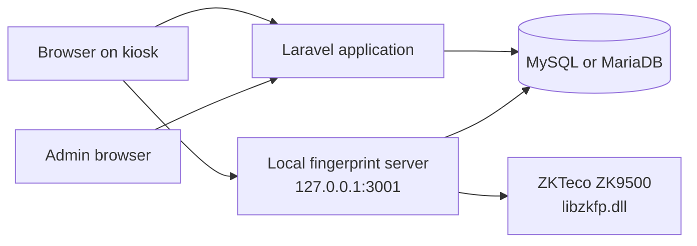

# Attendance Monitoring System

A Windows-based attendance and visitor monitoring system for employees and faculty. It combines a Laravel web application, a MySQL or MariaDB database, and a separate local Node.js service that communicates with a ZKTeco ZK9500 fingerprint scanner.

This documentation set was refreshed from repository commit `917b7ae`. The documentation files may contain uncommitted changes; check `git log -1` before treating a commit hash as final. The instructions are written for Windows and PowerShell.

> Hardware notice: the ZK9500 scanner and its SDK were not available in the environment used to prepare these documents. Scanner detection, enrollment, matching, and attendance recording through the physical device remain hardware-dependent and must be verified on the target kiosk PC.

## Start Here

For a beginner-friendly, sequential installation on one Windows computer, start with:

1. [TECHNICIAN_SETUP_GUIDE.md](TECHNICIAN_SETUP_GUIDE.md)
2. [TECHNICIAN_QUICK_REFERENCE.md](TECHNICIAN_QUICK_REFERENCE.md)
3. [DATABASE_COMPATIBILITY.md](DATABASE_COMPATIBILITY.md)

The database recommendation is not final. MariaDB 10.4.32 is the known development baseline and is end-of-life. Test a newer candidate before storing real school data.

## Implemented Features

- Admin login and public account registration.
- Employee and faculty record management.
- Automatic employee number generation in the form `EMP-YYYY-###`.
- Active and inactive employee statuses.
- Department assignment.
- Work schedules with multiple days and multiple time groups per employee.
- Schedule conflict detection.
- Attendance reporting with department, employee, and date filters.
- Printable attendance and employee-list pages.
- Per-employee attendance calendar.
- Manual attendance entry by an authenticated user.
- ZK9500 fingerprint enrollment and attendance scanning.
- A separate Windows Hello/WebAuthn biometric flow.
- Up to four time-in/time-out pairs per employee per day through the ZK9500 flow.
- Dashboard totals and a seven-day attendance chart.
- Public visitor registration with photo upload or webcam capture.
- Visitor check-in and check-out.
- Visitor log with filters. The CSV export route exists but currently raises a datetime formatting error.
- Local/offline deployment support.

## Not Implemented

The following are not implemented as modules in this repository:

- Leave management, leave balances, leave requests, or leave approvals. `Leave` exists only as an attendance status value.
- Holiday management or automatic holiday calendars.
- Contract compliance tracking.
- Payroll or salary computation.
- Role-based access control. Every registered user can access all authenticated admin routes.
- Excel, PDF, or PowerPoint report generation. Reports are printed with the browser. The visitor CSV export route is present but currently defective.
- A production-grade test suite. The repository contains framework example tests only.

## Technology Stack

| Component | Version or Requirement |
| --- | --- |
| PHP | 8.2 or newer; the project was inspected on PHP 8.2.12. Newer PHP versions require testing. |
| Laravel | 12.x |
| Composer | 2.x |
| Database | MySQL or MariaDB. MariaDB 10.4.32 is the verified development baseline but is EOL. The deployment target is still being tested; see [DATABASE_COMPATIBILITY.md](DATABASE_COMPATIBILITY.md). |
| Web server | Apache from XAMPP, or `php artisan serve` for local testing |
| Node.js | Required for the fingerprint server; Node 22.12+ or 20.19+ is recommended for compatibility with the root Vite toolchain |
| Fingerprint server | Express, `mysql2`, `ws`, and `koffi` |
| Scanner | ZKTeco ZK9500 with the ZKFinger SDK / `libzkfp.dll` |
| Frontend | Committed Bootstrap, Font Awesome, and Chart.js assets under `public/vendor` |

### Node.js Clarification

Node.js is **not required to run the Laravel interface** because the current Blade layouts use committed assets under `public/vendor` and do not reference Vite.

Node.js **is required to install and run the separate fingerprint server** in `fingerprint-server`.

The root `package.json` declares Vite 7.3.2, which requires Node `^20.19.0` or `>=22.12.0`. Use a compatible Node release if you choose to install the root frontend tooling.

## Architecture

- Laravel serves the admin interface, public kiosk, visitor registration, reports, and WebAuthn endpoints.
- The fingerprint server runs on the same kiosk PC as the scanner and listens on port `3001`.
- Laravel and the fingerprint server must use the same database.
- The fingerprint server records attendance directly in the shared database.

## Quick Start

For the one-computer technician path, use [TECHNICIAN_SETUP_GUIDE.md](TECHNICIAN_SETUP_GUIDE.md). The summary below is only an overview.

### Stage 1: Software Only

1. Install PHP, Composer, MySQL/MariaDB, and a web server.
2. Clone the repository.
3. Create the `attendance_app` database.
4. Configure `.env`.
5. Install Composer dependencies.
6. Run the migrations.
7. Create the storage link.
8. Start Laravel.
9. Register the first account.

Follow [INSTALLATION.md](INSTALLATION.md) for the exact commands.

At the end of Stage 1, the dashboard, employees, schedules, visitors, manual attendance, and reports should work. Biometric attendance will not work until the fingerprint service and scanner are configured.

### Stage 2: ZK9500 Hardware

1. Install the ZKFinger SDK and required runtime.
2. Configure `fingerprint-server\.env`.
3. Install the fingerprint server dependencies.
4. Start the fingerprint server with `npm start`.
5. Confirm the health endpoint reports a real, non-simulation scanner.
6. Enroll an employee fingerprint from the admin interface.
7. Test attendance from the kiosk.

Follow [FINGERPRINT_SETUP.md](FINGERPRINT_SETUP.md).

## Documentation Map

| Document | Purpose |
| --- | --- |
| [TECHNICIAN_SETUP_GUIDE.md](TECHNICIAN_SETUP_GUIDE.md) | Beginner-friendly, sequential setup for one Windows computer |
| [TECHNICIAN_QUICK_REFERENCE.md](TECHNICIAN_QUICK_REFERENCE.md) | Daily commands, startup order, health checks, backup, and common fixes |
| [DATABASE_COMPATIBILITY.md](DATABASE_COMPATIBILITY.md) | Verified database facts, candidates, test gates, and migration risks |
| [INSTALLATION.md](INSTALLATION.md) | Detailed Windows installation reference |
| [FINGERPRINT_SETUP.md](FINGERPRINT_SETUP.md) | ZK9500 SDK, DLL, fingerprint server, enrollment, and scanning |
| [PROJECT_WORKFLOW.md](PROJECT_WORKFLOW.md) | Features, routes, data model, attendance rules, and workflows |
| [DEPLOYMENT.md](DEPLOYMENT.md) | Production deployment, startup, backup, upgrade, and security |
| [COMMAND_REFERENCE.md](COMMAND_REFERENCE.md) | PowerShell commands, health checks, PM2 options, and troubleshooting |

The older `setup.md` file is a combined setup guide from an earlier revision. Use the guides above as the current reference.

## Main Routes

### Public Routes

| Route | Purpose |
| --- | --- |
| `/kiosk` | Public kiosk landing page |
| `/visitor/register` | Visitor registration form |
| `/visitor` | Today's visitors as JSON |
| `/scan/employee` | Windows Hello/WebAuthn scan page |
| `/scan/employee/zk9500` | ZK9500 attendance kiosk |
| `/scan/employee/zk9500/prototype` | ZK9500 prototype page |
| `/login` | Login page |
| `/register` | Public account registration |
| `/up` | Laravel health endpoint |

Visitor `POST` and checkout routes are public. Visitor routes are exempt from CSRF protection in `bootstrap/app.php`.

### Authenticated Routes

| Route | Purpose |
| --- | --- |
| `/dashboard` | Dashboard |
| `/attendance/employee` | Employee attendance report |
| `/attendance/employee/print` | Printable attendance report |
| `/attendance/employee/{id}/calendar` | Employee attendance calendar |
| `/attendance/visitor` | Visitor log |
| `/attendance/visitor/export` | Visitor CSV export route (currently defective) |
| `/users` | Employee, visitor, and schedule-template management |
| `/schedule` | Schedule management for a selected employee |
| `/scan/employee/zk9500/enroll` | ZK9500 fingerprint enrollment |
| `/webauthn/*` | Windows Hello enrollment and verification endpoints |

## Admin Account Creation

There is no separate administrator role. The application treats every authenticated user as an administrator.

The actual account creation process is:

1. Open `/register`.
2. Enter a name, password, and password confirmation.
3. The application creates the user with an internal generated email address in the form `<name-slug>-<timestamp>@local.test`.
4. The new user is logged in automatically and redirected to `/dashboard`.

Login accepts either the account name or the generated email address.

The optional `php artisan db:seed` command runs `DatabaseSeeder`, which creates a development test account using the framework factory's known test password. That seeder is not an administrator-provisioning mechanism and should not be used on a production kiosk. Change or remove any seeded test account before deployment.

Because `/register` is public, anyone who can reach the application can create an admin-level account. Restrict network access to the kiosk and admin interface, or place the application behind an authenticated reverse proxy.

## Security and Operational Notes

- The fingerprint server API has no authentication. Keep port `3001` on the local machine or protect it with Windows Firewall. Do not expose it to the internet.
- The application has no role separation. All authenticated users can modify employees, schedules, attendance, visitors, and fingerprints.
- Public visitor routes are intentionally CSRF-exempt. Do not expose them more broadly than required.
- Production mode forces HTTPS URL generation. A production deployment served only over plain HTTP will generate incorrect URLs.
- Use a dedicated database user with limited privileges for production instead of the XAMPP `root` account.
- Back up the database and uploaded visitor photos before upgrades.
- The visitor CSV export currently throws `Carbon\Exceptions\InvalidFormatException` because it parses a datetime-cast value with a time-only format. The route exists, but do not rely on CSV export until the source is corrected.
- Avoid `php artisan migrate:fresh` on any database that contains real attendance or visitor records.
- A known MySQL/MariaDB key-length issue can occur during migration on older configurations. See [INSTALLATION.md](INSTALLATION.md#troubleshooting-the-1071-key-length-error).
- MariaDB 10.4.32 is end-of-life and is not the recommended database for a new school computer. Read [DATABASE_COMPATIBILITY.md](DATABASE_COMPATIBILITY.md) before selecting or upgrading the database.

## Verification Scope

The repository inspection verified the routes, migrations, models, controllers, fingerprint server structure, environment keys, and bundled DLL. The following were not verified:

- A fresh installation of the newer database candidates.
- Migrations, application workflows, or the fingerprint server against XAMPP 8.3.36's installed MariaDB version.
- Migrations or data import against MariaDB 11.4.
- Physical ZK9500 detection.
- Fingerprint capture quality.
- Fingerprint enrollment on a real device.
- Fingerprint matching against a real enrolled template.
- Physical scanner attendance recording.
- PM2 startup on Windows, because PM2 is not configured in this repository.

Use [DATABASE_COMPATIBILITY.md](DATABASE_COMPATIBILITY.md) for the database test gates, [FINGERPRINT_SETUP.md](FINGERPRINT_SETUP.md) for hardware setup, and the post-deployment checklist in [DEPLOYMENT.md](DEPLOYMENT.md) to complete verification on the target machine.
